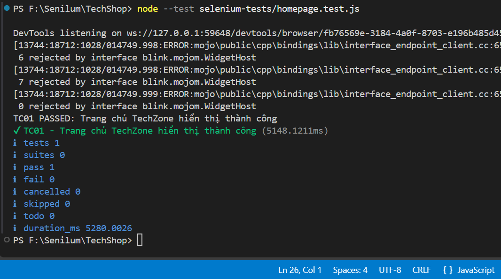
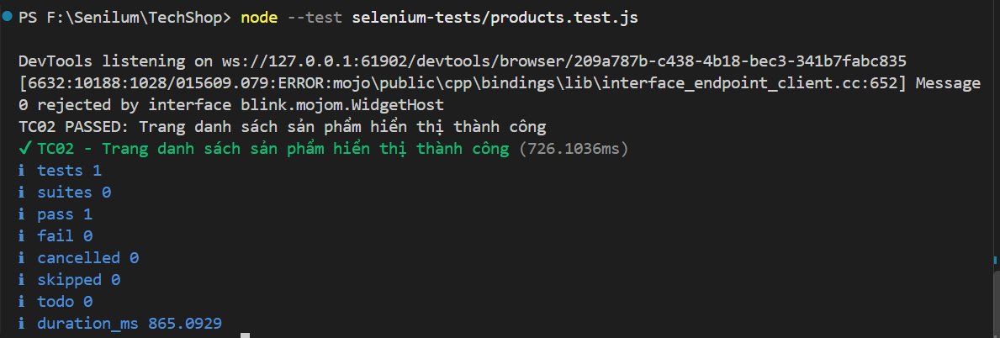
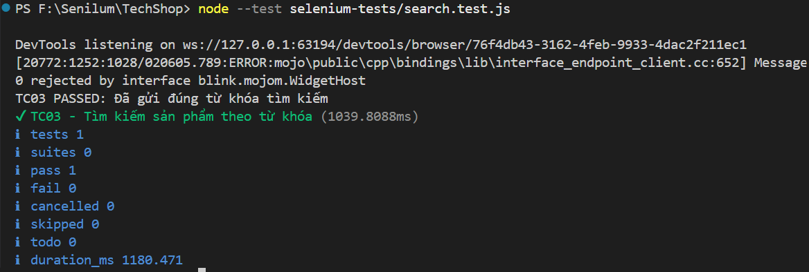
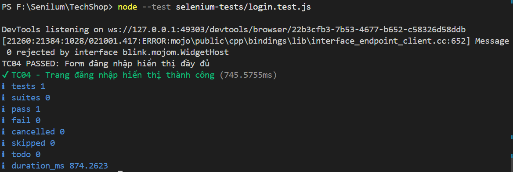
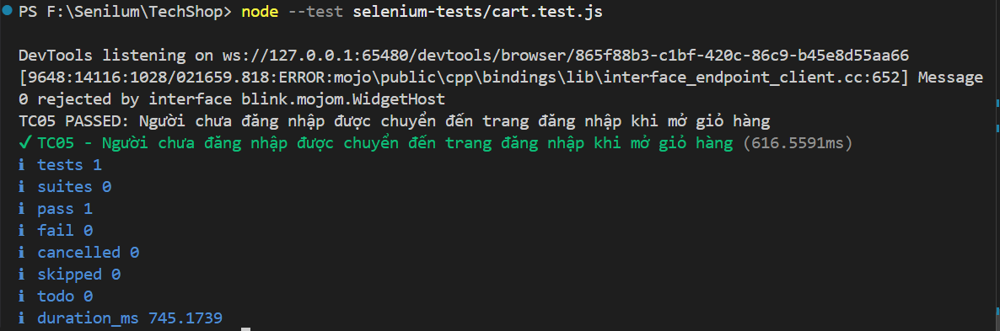
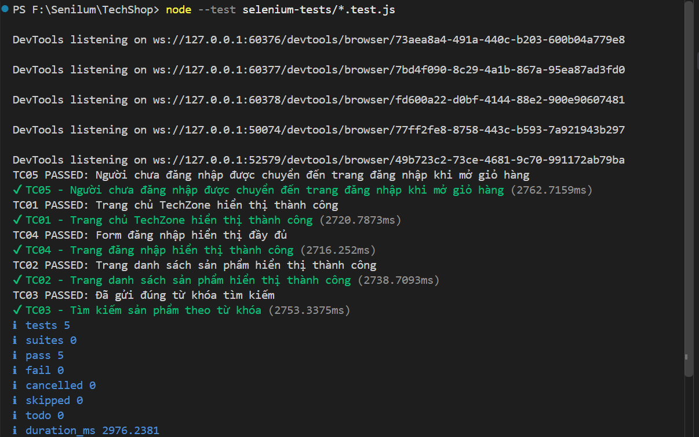

# Lab 9 — Kiểm thử tự động bằng Selenium WebDriver

## 1. Giới thiệu

Bài thực hành này sử dụng Selenium WebDriver kết hợp với JavaScript để thực hiện kiểm thử tự động một số chức năng giao diện của website TechZone.

Mục tiêu là làm quen với Selenium WebDriver, xây dựng các test case tự động, kiểm tra kết quả thực tế và tổng hợp kết quả kiểm thử.

## 2. Công nghệ sử dụng

- **Website kiểm thử:** TechZone (TechShop)
- **Ngôn ngữ lập trình:** JavaScript
- **Môi trường chạy:** Node.js
- **Công cụ kiểm thử trình duyệt:** Selenium WebDriver
- **Bộ chạy kiểm thử:** Node.js Test Runner (`node:test`)
- **Trình duyệt:** Google Chrome
- **Hệ điều hành:** Windows

### Phiên bản môi trường

| Thành phần | Phiên bản |
|---|---|
| Node.js | v24.16.0 |
| npm | 11.13.0 |
| Selenium WebDriver | Được cài đặt qua npm |
| Google Chrome | Được sử dụng để chạy kiểm thử |

## 3. Cấu trúc thư mục

```text
TechShop/
├── public/
├── routes/
├── models/
├── views/
├── selenium-tests/
│   ├── screenshots/
│   │   ├── TC01-homepage.png
│   │   ├── TC02-products.png
│   │   ├── TC03-search.png
│   │   ├── TC04-login.png
│   │   ├── TC05-cart.png
│   │   └── all-tests.png
│   ├── homepage.test.js
│   ├── products.test.js
│   ├── search.test.js
│   ├── login.test.js
│   └── cart.test.js
├── .gitignore
├── package.json
├── package-lock.json
└── README.md
```
## 4. Cài đặt môi trường

### Bước 1: Cài đặt Node.js

Cài đặt Node.js và kiểm tra phiên bản bằng các lệnh:

```bash
node -v
npm -v
```

### Bước 2: Cài đặt các thư viện

Mở Terminal tại thư mục gốc của dự án và chạy:

```bash
npm ci
```

Lệnh này cài đặt các thư viện theo danh sách phụ thuộc được ghi trong `package-lock.json`, bao gồm Selenium WebDriver nếu thư viện đã được khai báo trong dự án.

### Bước 3: Khởi động website

Mở Terminal thứ nhất và chạy lệnh khởi động website theo cấu hình của dự án. Với dự án hiện tại, sử dụng:

```bash
npm start
```

Đảm bảo website truy cập được tại địa chỉ:

`http://127.0.0.1:3000`

Giữ Terminal này hoạt động trong suốt quá trình kiểm thử.

## 5. Danh sách test case

### TC01 — Kiểm tra trang chủ

**Mục tiêu:** Kiểm tra trang chủ TechZone có thể mở và hiển thị các thành phần cơ bản.

**Các bước thực hiện:**
1. Mở trình duyệt Chrome bằng Selenium WebDriver.
2. Truy cập `http://127.0.0.1:3000/`.
3. Kiểm tra tiêu đề trang.
4. Kiểm tra logo trang chủ có hiển thị hay không.

**Kết quả mong đợi:** Trang chủ mở thành công, tiêu đề và logo hiển thị đúng.

**Kết quả thực tế:** PASS.

### TC02 — Kiểm tra trang danh sách sản phẩm

**Mục tiêu:** Kiểm tra trang danh sách sản phẩm hiển thị thành công.

**Các bước thực hiện:**
1. Truy cập `http://127.0.0.1:3000/products`.
2. Kiểm tra tiêu đề “Tất cả sản phẩm”.
3. Kiểm tra ô tìm kiếm hiển thị.
4. Kiểm tra danh sách có ít nhất một thẻ sản phẩm.

**Kết quả mong đợi:** Trang danh sách sản phẩm và các thành phần cần thiết được hiển thị.

**Kết quả thực tế:** PASS.

### TC03 — Kiểm tra tìm kiếm sản phẩm

**Mục tiêu:** Kiểm tra người dùng có thể nhập và gửi từ khóa tìm kiếm.

**Các bước thực hiện:**
1. Mở trang danh sách sản phẩm.
2. Nhập từ khóa `SSD Kingston`.
3. Nhấn nút tìm kiếm.
4. Kiểm tra URL tìm kiếm và xác nhận tham số `q` chứa đúng từ khóa đã nhập.

**Kết quả mong đợi:** Hệ thống gửi đúng từ khóa tìm kiếm lên URL.

**Kết quả thực tế:** PASS.

**Lưu ý:** Test case này xác nhận từ khóa được gửi chính xác, chưa kiểm tra nội dung danh sách kết quả có khớp với từ khóa hay không.

### TC04 — Kiểm tra giao diện đăng nhập

**Mục tiêu:** Kiểm tra các thành phần cơ bản của trang đăng nhập.

**Các bước thực hiện:**
1. Truy cập trang đăng nhập tại `/login`.
2. Kiểm tra form đăng nhập hiển thị.
3. Kiểm tra trường số điện thoại.
4. Kiểm tra trường mật khẩu.
5. Kiểm tra nút đăng nhập.

**Kết quả mong đợi:** Form đăng nhập và các trường nhập liệu cần thiết đều hiển thị.

**Kết quả thực tế:** PASS.

**Lưu ý:** Test case này kiểm tra giao diện, chưa thực hiện xác thực đăng nhập bằng tài khoản.

### TC05 — Kiểm tra chuyển hướng khi truy cập giỏ hàng chưa đăng nhập

**Mục tiêu:** Kiểm tra hành vi bảo vệ trang giỏ hàng đối với người dùng chưa đăng nhập.

**Các bước thực hiện:**
1. Truy cập `http://127.0.0.1:3000/cart`.
2. Kiểm tra hệ thống chuyển hướng đến trang đăng nhập.
3. Kiểm tra tham số `returnTo` giữ lại đường dẫn `/cart`.
4. Kiểm tra trang đăng nhập hiển thị trường số điện thoại và mật khẩu.

**Kết quả mong đợi:** Người chưa đăng nhập được chuyển đến trang đăng nhập và đường dẫn giỏ hàng ban đầu được giữ lại.

**Kết quả thực tế:** PASS.

**Lưu ý:** Test case này kiểm tra chuyển hướng, chưa kiểm tra thao tác sử dụng giỏ hàng sau khi đăng nhập.

## 6. Cách chạy kiểm thử

Sau khi website đã được khởi động ở Terminal thứ nhất, mở Terminal thứ hai tại thư mục gốc dự án.

Chạy từng test case:

```bash
node --test selenium-tests/homepage.test.js
node --test selenium-tests/products.test.js
node --test selenium-tests/search.test.js
node --test selenium-tests/login.test.js
node --test selenium-tests/cart.test.js
```

Để chạy toàn bộ test case trong thư mục `selenium-tests/`:

```bash
node --test selenium-tests/*.test.js
```

Selenium sẽ tự động mở Chrome, thực hiện các thao tác kiểm thử và đóng phiên trình duyệt sau khi hoàn thành từng test case.

## 7. Kết quả kiểm thử

Sau khi chạy toàn bộ các test case, kết quả ghi nhận được như sau:

| Chỉ số | Kết quả |
|---|---:|
| Tổng số test case | 5 |
| Số test case thành công | 5 |
| Số test case thất bại | 0 |
| Số test case bị hủy | 0 |
| Số test case bị bỏ qua | 0 |

**Tỷ lệ thành công:** 100% (5/5 test case).

Các test case đều PASS trong lần chạy tổng thể trên môi trường kiểm thử cục bộ.

## 8. Kết luận

Qua bài thực hành, em đã làm quen với Selenium WebDriver và sử dụng JavaScript để tự động hóa việc kiểm thử giao diện website TechZone.

Bài thực hành đã xây dựng và chạy thành công 5 test case, bao gồm kiểm tra trang chủ, danh sách sản phẩm, thao tác tìm kiếm, giao diện đăng nhập và hành vi chuyển hướng khi truy cập giỏ hàng chưa đăng nhập.

Kết quả cho thấy cả 5 test case đều PASS trong lần chạy kiểm thử đã thực hiện. Qua đó, em hiểu thêm cách sử dụng bộ kiểm thử tự động, tìm phần tử trên giao diện bằng CSS selector, kiểm tra kết quả bằng assertion và tổng hợp kết quả chạy test.

Trong tương lai, có thể mở rộng bộ kiểm thử để xác nhận nội dung kết quả tìm kiếm, kiểm thử đăng nhập bằng tài khoản thử nghiệm và kiểm thử các thao tác thêm, xóa sản phẩm trong giỏ hàng.

## 9. Ảnh minh chứng

### TC01 — Kiểm thử trang chủ



### TC02 — Kiểm thử danh sách sản phẩm



### TC03 — Kiểm thử tìm kiếm sản phẩm



### TC04 — Kiểm thử giao diện đăng nhập



### TC05 — Kiểm thử chuyển hướng khi truy cập giỏ hàng chưa đăng nhập



### Kết quả chạy toàn bộ test case




